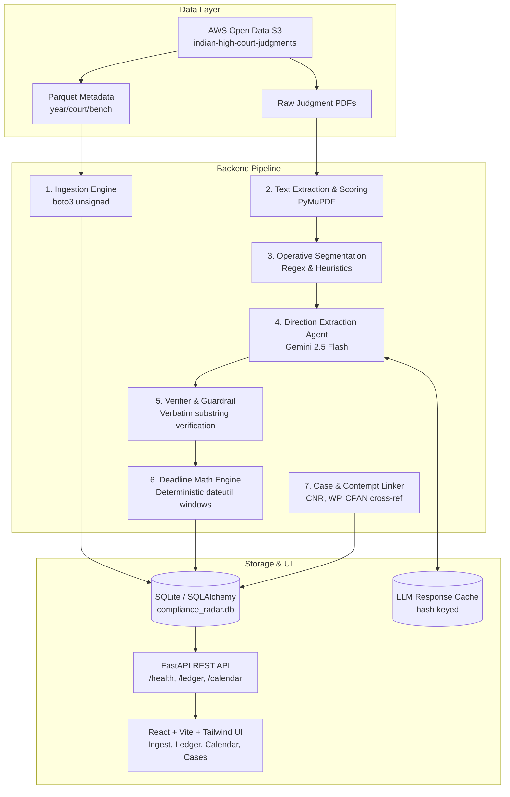

# Court-Order Compliance Radar

An AI-powered compliance monitoring platform that ingests real Indian High Court judgments from official open data (AWS Open Data public S3 bucket `indian-high-court-judgments`), extracts operative directions against government departments with verifiable source quotes, computes deterministic compliance deadline windows, and links subsequent orders and contempt proceedings to track compliance status.



---

## Key Features

1. **Zero Mock Data Hard Rule**: Every record shown is ingested live from the public AWS Open Data bucket `indian-high-court-judgments` (`CC-BY-4.0`, public unsigned S3 access).
2. **Operative Direction Extraction**: Automatically extracts `{responsible_party, party_type, action, deadline_phrase, source_quote, confidence}`.
3. **Verbatim Quote Guardrail**: Rejects hallucinations by enforcing that `source_quote` is a strict verbatim substring of the underlying judgment text.
4. **Deterministic Deadline Windows**: Receipt dates for government departments are unknown; the engine calculates an estimated delivery window `[judgment_date + N, judgment_date + N + SERVICE_LAG_DAYS]` where `SERVICE_LAG_DAYS` defaults to 30 days.
5. **Case Linking & Follow-Up**: Links later orders in the same matter (CNR, case number, contempt citations `CPAN` in `WPA`) to classify status into `COMPLIED`, `PENDING`, `LAPSED_NO_RECORD`, or `UNVERIFIED`.
6. **LLM Cost & Concurrency Protection**: Caches LLM requests keyed by `sha256(prompt + text)` in SQLite and limits concurrency with exponential backoff.

---

## Project Structure

```text
├── backend/
│   ├── app/
│   │   ├── config.py         # Pydantic Settings (.env loader)
│   │   ├── database.py       # SQLite engine and session factory
│   │   ├── models.py         # SQLAlchemy ORM models
│   │   └── main.py           # FastAPI entry point & GET /health
│   ├── pipeline/             # Ingestion, segmentation, LLM agent, linker
│   ├── tests/                # Pytest test suite
│   │   └── test_health.py    # Health endpoint & DB test
│   └── requirements.txt      # Python dependencies
├── frontend/                 # Vite + React (TypeScript) + Tailwind CSS
├── docs/
│   └── dataset_notes.md      # Live S3 discovery notes & court evaluation
├── eval/                     # Hand-labelled gold evaluation set
├── scripts/
│   └── explore_bucket.py     # Live S3 exploration script (unsigned botocore)
├── .env.example              # Environment variables template
├── .gitignore                # Git ignore patterns
└── README.md
```

---

## Quickstart

### 1. Prerequisites
- Python 3.11+
- Node.js 18+ and npm

### 2. Backend Setup
```bash
# Create and activate virtual environment
python -m venv .venv
# Windows:
.venv\Scripts\activate
# Linux/macOS:
source .venv/bin/activate

# Install dependencies
pip install -r backend/requirements.txt

# Configure environment
cp .env.example .env

# Run tests
pytest
```

### 3. Run FastAPI Backend
```bash
uvicorn backend.app.main:app --reload --port 8000
```
Visit http://127.0.0.1:8000/docs for Swagger UI and http://127.0.0.1:8000/health for health check.

### 4. Explore S3 Dataset Live
```bash
python scripts/explore_bucket.py
```
This connects unsigned to `indian-high-court-judgments`, inspects metadata parquet files, verifies PDF linkage, and updates `docs/dataset_notes.md`.

### 5. Frontend Setup
```bash
cd frontend
npm install
npm run dev
```
Open http://localhost:3000 in your browser.

---

## Evaluation Benchmark
To run the ground-truth accuracy evaluations on the hand-labelled gold set:
```bash
pytest backend/tests/test_eval.py -v
```

---

## Dataset Recommendation
- **Recommended Court:** Calcutta High Court (Appellate Side) (`court=19_16`, `bench=calcutta_appellate_side`)
- **Recommended Year:** 2023
- **Primary Reasons:**
  - 50.5% (36,355 orders) are Writ Petitions (`WPA`) against government departments.
  - 6,134 Contempt Petitions (`CPAN`) explicitly linked to original WPAs for follow-up verification.
  - 100% digital vector text readable by PyMuPDF without OCR.
  - Complete calendar progression allowing mature compliance window resolution (`COMPLIED`, `LAPSED_NO_RECORD`).
